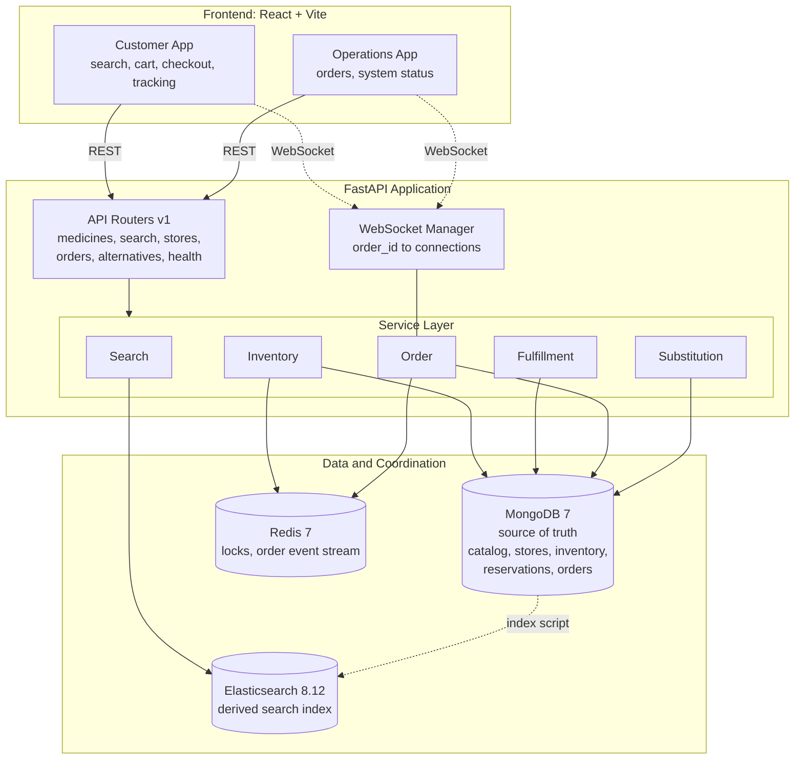
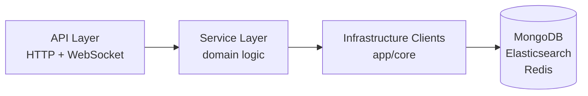
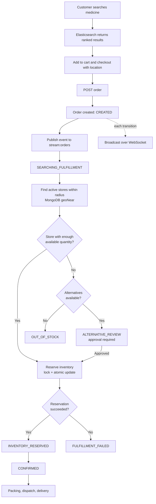
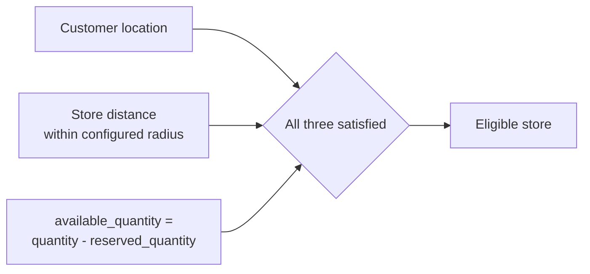
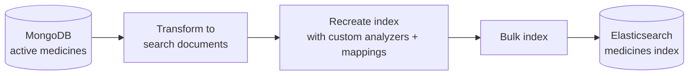
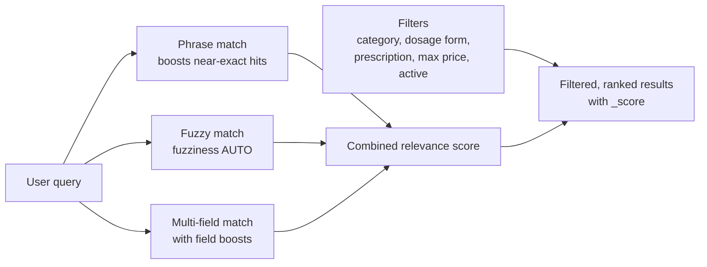
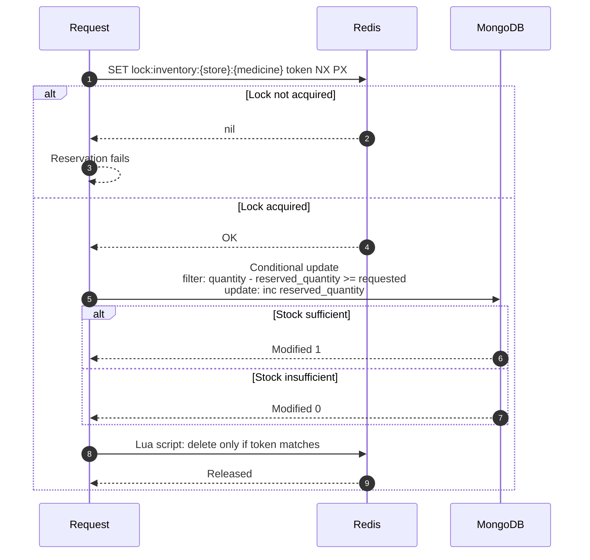
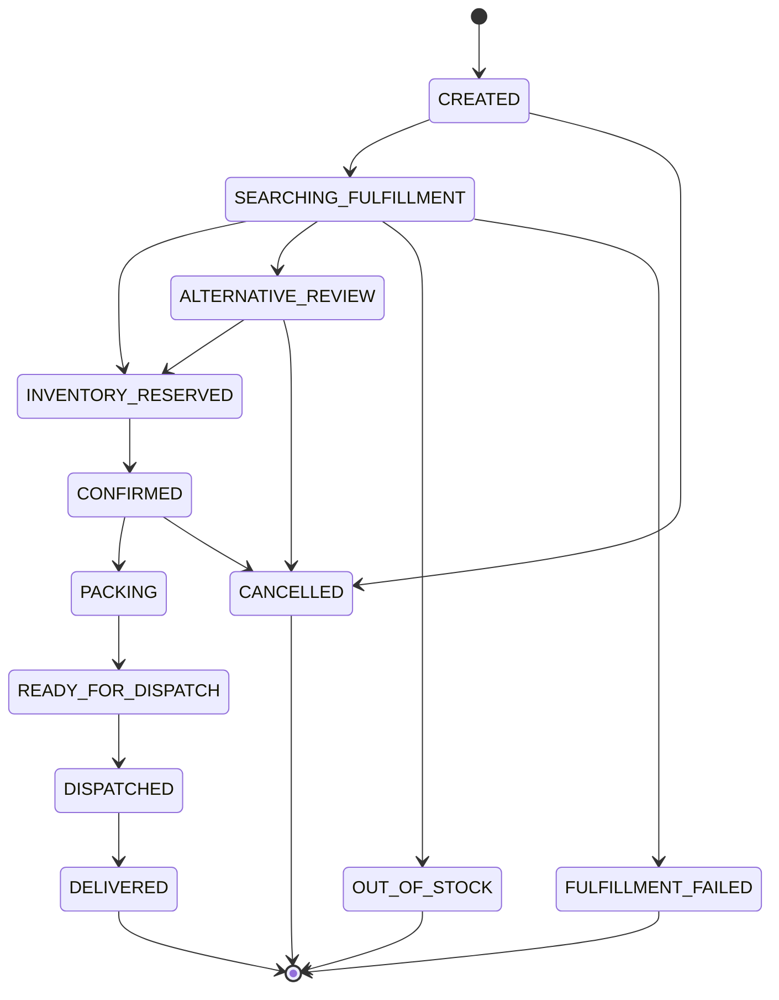
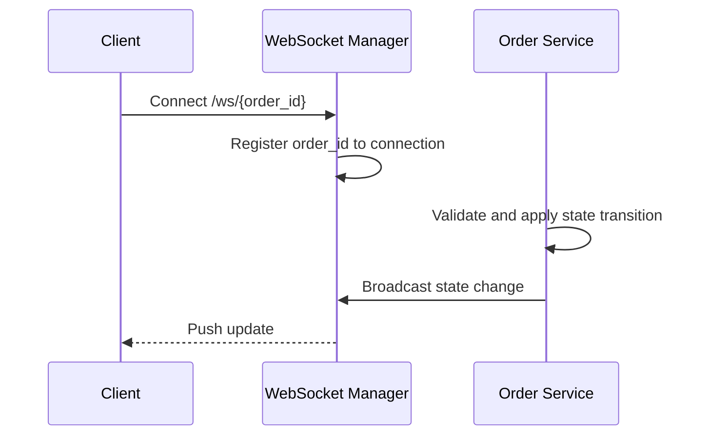
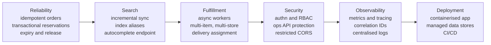

<div align="center">

# PULSERX

### Backend architecture for medicine commerce.

Fuzzy search, inventory-aware fulfillment, concurrency-safe reservations, and a stateful order lifecycle.

<br>


[Overview](#overview) · [Architecture](#system-architecture) · [Workflows](#core-workflows) · [Search](#search-engine) · [Reservations](#inventory-reservation) · [Orders](#order-lifecycle) · [API](#api-surface) · [Quick Start](#quick-start) · [Roadmap](#roadmap)

</div>

---

## Overview

PulseRx is a modular backend for medicine commerce. It is built around problems that a conventional product catalog never has to solve:

| Problem | How PulseRx addresses it |
|---|---|
| Users misspell drug names | Elasticsearch with fuzzy matching, phrase boosting, and edge-ngram indexing |
| Availability depends on physical stock nearby | Geospatial store discovery combined with per-store inventory checks |
| Two customers can claim the last unit | Redis distributed lock plus an atomic conditional MongoDB update |
| Orders are a process, not a single status | Validated state machine with timestamped history |
| Customers want live status | WebSocket subscriptions per order |
| Alternatives must match clinically relevant attributes | Attribute-based candidate ranking with an explicit approval flag |

The system is structured as separate service layers for search, inventory, fulfillment, orders, and substitution. It is not a CRUD application with a search box.

### Capabilities

| Domain | Included |
|---|---|
| Catalog | Medicine records with brand, salt, strength, dosage form, route, pack size, price, prescription flag |
| Search | Typo tolerance, relevance ranking, autocomplete-oriented indexing, category / dosage form / price / prescription filters |
| Fulfillment | Nearest-store lookup using `$geoNear`, availability-aware store selection |
| Inventory | Concurrent reservation, lock-safe release, reservation expiry metadata |
| Orders | Twelve-state lifecycle, transition validation, history log, Redis Stream event publishing |
| Real time | WebSocket tracking for customers and an operations feed |
| Substitution | Ranked alternatives with matched attributes, warnings, and store availability |
| Operations | Liveness and dependency-readiness health checks with per-service latency |
| Testing | Async inventory concurrency stress test |

---

## System Architecture



**Data ownership**

| Store | Role | Holds |
|---|---|---|
| MongoDB | Authoritative | Medicines, stores, inventory, reservations, orders |
| Elasticsearch | Derived | Search representation of active medicines. Never the source of truth. |
| Redis | Ephemeral | Short-lived inventory locks and the `stream:orders` event stream |

### Layering



Routers handle transport only. All business rules live in service classes, and connection setup is centralised under `app/core`. This keeps domain logic independent of HTTP and testable in isolation.

---

## Core Workflows

### Order placement, end to end



### Fulfillment selection

Nearest store alone is not enough. Selection considers three conditions together:



Store locations are GeoJSON points backed by a `2dsphere` index. Each result includes the calculated distance in kilometres.

### Search indexing pipeline



Run through `backend/scripts/index_elasticsearch.py`. MongoDB remains the source of truth, and the index can always be rebuilt from it.

---

## Search Engine

Search is separated from the transactional database because medicine discovery needs relevance scoring, fuzziness, and prefix matching that document retrieval does not provide.

### Query strategy



| Technique | Behaviour | Example |
|---|---|---|
| Phrase matching | Precise phrases receive additional weight | `Crocin 650` outranks a looser match |
| Fuzzy matching | Tolerates common spelling errors | `paracitamol`, `crocin suspention` |
| Field boosting | `name` highest, then `salt`, `brand`, `generic_name`, `description` | Name hits dominate ranking |
| Filters | Applied separately from scoring | Filtering never distorts relevance |

### Index design

Index name: `medicines`

The autocomplete analyzer chains a standard tokenizer, lowercase filter, and edge-ngram filter (`min_gram = 2`, `max_gram = 15`). A separate analyzer is used at query time so user input is not itself ngram-expanded.

| Field | Mapping | Purpose |
|---|---|---|
| `name`, `brand`, `salt` | text + keyword subfield | Full-text search and exact matching |
| `generic_name` | text | Full-text search |
| `strength`, `dosage_form`, `route`, `category` | keyword | Exact filtering |
| `price` | double | Range filtering |
| `prescription_required` | boolean | Filtering |

### Endpoint

```http
GET /api/v1/search/medicines?q=paracetamol&dosage_form=Tablet&max_price=100&page=1&page_size=20
```

Response fields: `query`, `total`, `page`, `page_size`, `total_pages`, `results`. Each result exposes its relevance as `_score`.

---

## Inventory Reservation

Reservation is the most concurrency-sensitive path in the system.

A naive implementation reads stock, checks it, then writes. Under concurrent requests, two customers can both observe the same stock before either write lands, and the last unit is sold twice.

PulseRx applies two independent layers of protection.



| Layer | Mechanism | Guarantee |
|---|---|---|
| Redis lock | `SET key value NX PX` on `store_id + medicine_id` with a unique owner token | Reduces contention. Only one caller proceeds per store and medicine at a time. |
| Safe release | Lua compare-and-delete on the owner token | A process can never release a lock it does not own. |
| Atomic update | Single conditional MongoDB update that checks availability and increments `reserved_quantity` in one operation | Overselling is prevented even if the lock layer fails. |

The database update is authoritative. The lock reduces contention but is not relied on for correctness.

### Verified behaviour

The stress test in `backend/tests/test_concurrency.py` resets one medicine to a single available unit, then fires ten concurrent reservations.

| Attempts | Successful | Failed | Reserved units | Oversold |
|---|---|---|---|---|
| 10 | 1 | 9 | 1 | 0 |

---

## Order Lifecycle

Orders are a state machine, not a free-form status field. The service layer validates every transition before writing, and each change is recorded in order history with a timestamp and note.



> The diagram shows the intended flow. The authoritative transition table lives in `order_service.py`.

### Real-time tracking



The connection manager maintains `order_id → active connections` plus a separate set for the operations dashboard, so customers get live updates without polling.

---

## Medicine Alternatives

When a requested medicine cannot be fulfilled, the substitution service ranks candidates by attribute similarity.

| Attribute | Role |
|---|---|
| Salt | Primary compatibility signal |
| Strength | Dosage match |
| Dosage form | Administration match |
| Route | Administration match |
| Price | Similarity scoring |

Each candidate returns a score, `matched_attributes`, `warnings`, store availability, and `requires_approval`.

**Every result is a candidate, not a decision.** The API marks alternatives as requiring user or pharmacist approval. The engine ranks options. It is not an autonomous clinical system.

---

## API Surface

Versioned under `/api/v1`. Interactive docs are served at `/docs` and `/redoc`.

| Method | Endpoint | Purpose |
|---|---|---|
| GET | `/api/v1/health` | Liveness |
| GET | `/api/v1/health/dependencies` | MongoDB, Redis, Elasticsearch readiness with latency |
| GET | `/api/v1/medicines` | List medicines (`limit`) |
| GET | `/api/v1/medicines/{medicine_id}` | Fetch one medicine |
| GET | `/api/v1/search/medicines` | Ranked search with filters and pagination |
| GET | `/api/v1/stores/nearby` | Active stores near `lng` / `lat` |
| GET | `/api/v1/alternatives/...` | Ranked substitution candidates |
| POST / GET | `/api/v1/orders/...` | Create, read, and transition orders |
| WS | `/ws/{order_id}` | Live order state updates |

### Dependency health

`/health` answers whether the process is alive. `/health/dependencies` answers whether it can do useful work. Keeping them separate lets you tell an infrastructure failure from an application failure.

```json
{
  "status": "healthy",
  "dependencies": {
    "mongodb":       { "status": "healthy", "latency_ms": 2.41 },
    "redis":         { "status": "healthy", "latency_ms": 0.72 },
    "elasticsearch": { "status": "healthy", "latency_ms": 4.18 }
  }
}
```

---

## Design Decisions

| Decision | Rationale |
|---|---|
| **MongoDB as source of truth** | Medicines, inventory, reservations, and orders need consistent state and a flexible document model. |
| **Elasticsearch as a derived index** | Relevance, fuzziness, boosting, and prefix analysis are search-engine strengths. Because it is derived, it can be rebuilt at any time. |
| **Redis for coordination only** | Low-latency locking and event publishing. Correctness never depends on Redis alone. |
| **Lock plus atomic write** | Defence in depth. The lock lowers contention, and the conditional update guarantees no oversell. |
| **State machine orders** | Invalid jumps such as `DELIVERED` to `PACKING` are rejected in one place. |
| **Service-layer separation** | Domain logic stays out of routers, so it is easier to test and to move behind workers later. |

---

## Tech Stack

| Layer | Technology |
|---|---|
| API | Python, FastAPI, Pydantic, Uvicorn |
| Data clients | Motor (async MongoDB), Elasticsearch Python client, Redis asyncio client |
| Infrastructure | MongoDB 7, Elasticsearch 8.12, Redis 7, Docker Compose |
| Frontend | React, Vite, React Router, Tailwind CSS |
| Testing | Pytest, Pytest Asyncio, custom concurrency stress test |

---

## Repository Structure

```text
pulserx/
├── backend/
│   ├── app/
│   │   ├── api/v1/          alternatives, health, medicines, orders, search, stores
│   │   ├── core/            config, database, elasticsearch, redis
│   │   ├── models/
│   │   ├── repositories/
│   │   ├── schemas/         inventory, medicine, order, store
│   │   ├── services/        fulfillment, inventory, order, search, substitution
│   │   ├── websocket/       connection_manager
│   │   └── workers/
│   ├── scripts/             seed_database.py, index_elasticsearch.py
│   ├── tests/               test_concurrency.py
│   └── requirements.txt
├── frontend/
│   └── src/                 components, contexts, layouts, pages (customer, ops), services
├── docker-compose.yml
├── .env.example
└── .gitignore
```

---

## Quick Start

**Prerequisites:** Docker and Docker Compose, Python 3.10+, Node.js 18+.

**1. Clone and configure**

```bash
git clone <repository-url>
cd pulserx
cp .env.example .env
```

```dotenv
PROJECT_NAME=PulseRx Engine
VERSION=1.0.0
API_V1_STR=/api/v1

MONGO_URI=mongodb://localhost:27017/pulserx
MONGO_DB_NAME=pulserx
ELASTICSEARCH_URL=http://localhost:9200
REDIS_URL=redis://localhost:6379/0

API_HOST=0.0.0.0
API_PORT=8000
```

Never commit credentials or environment-specific secrets.

**2. Start infrastructure**

```bash
docker compose up -d
docker compose ps
```

**3. Backend setup**

```bash
cd backend
python -m venv .venv
source .venv/bin/activate          # Windows: .venv\Scripts\activate
pip install -r requirements.txt
```

**4. Seed data and build the search index**

```bash
python scripts/seed_database.py
python scripts/index_elasticsearch.py
```

The seed script loads stores, medicines, and inventory, and creates the MongoDB indexes (geospatial, inventory, orders, reservations). The index script recreates the `medicines` index and bulk-loads active records from MongoDB.

**5. Run the API**

```bash
uvicorn app.main:app --reload --host 0.0.0.0 --port 8000
```

Docs are available at `http://localhost:8000/docs`.

**6. Run the frontend**

```bash
cd frontend
npm install
npm run dev
```

**7. Run the concurrency test**

```bash
python tests/test_concurrency.py
```

---

## Current Scope and Boundaries

PulseRx is a development-focused implementation. These boundaries are deliberate and documented, not hidden.

| Area | Current state |
|---|---|
| Search indexing | Explicit script run, not incremental sync |
| Order events | Published to `stream:orders`, while fulfillment currently runs directly in the API service |
| Reservations | Expiry metadata is stored, automatic release is not yet implemented |
| Infrastructure | Single-node Docker Compose for local use |
| Security | Authentication and authorization are out of scope for now |
| Integrations | No payment, delivery-partner, or pharmacy-system integration |

---

## Roadmap



| Track | Planned work |
|---|---|
| Reliability | Idempotent order creation, transactional reservation with rollback, reservation expiry and stock release, retry and failure handling, structured logging |
| Search | Incremental MongoDB to Elasticsearch sync, index versioning, alias-based index replacement, search analytics, dedicated autocomplete endpoint, cursor pagination |
| Orders | Async order workers, multi-item fulfillment across stores, delivery assignment and status, retry and recovery workflows |
| Security | Authentication, role-based authorization, operations API protection, restricted CORS, hardened Elasticsearch |
| Observability | Metrics, distributed tracing, centralised logs, request correlation IDs, infrastructure dashboards |
| Infrastructure | Containerised deployment, managed data services, horizontal API scaling, worker autoscaling, load balancing, CI/CD |

---

## Project Status

PulseRx is an actively developed engineering project exploring backend architecture for medicine commerce and quick-commerce workflows. It provides a working foundation for catalog search, inventory-aware fulfillment, and order lifecycle management, with production hardening tracked openly in the roadmap above.

---

<div align="center">

**Author:** *Aayush Shukla*

</div>
